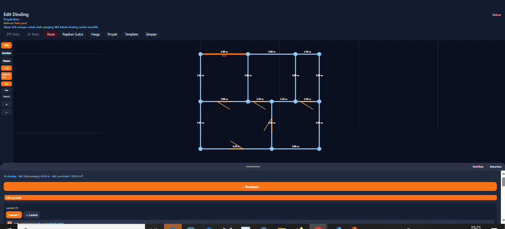
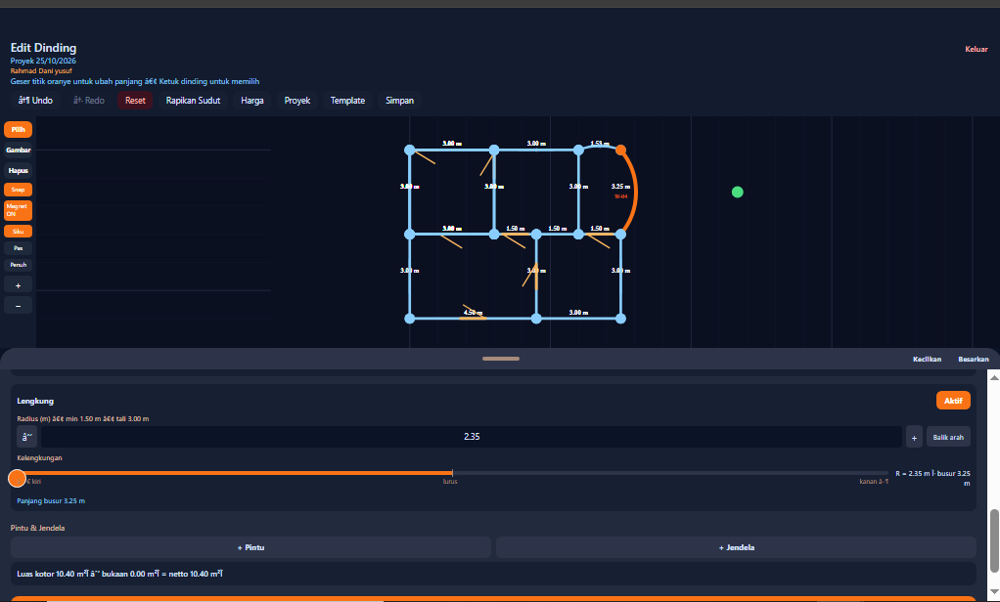
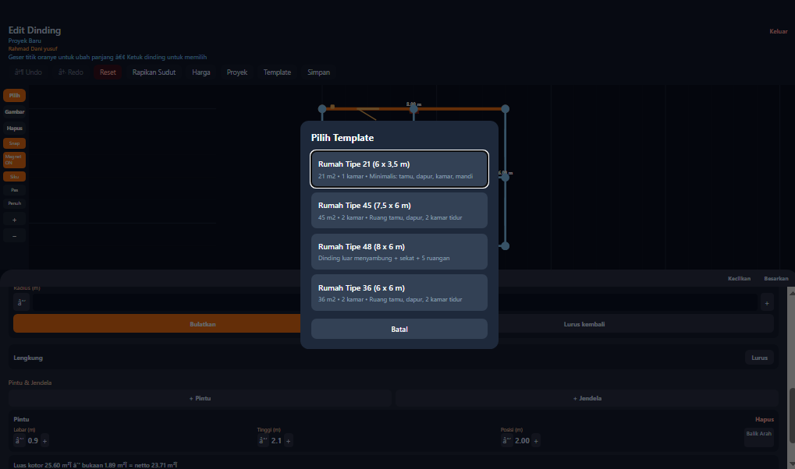
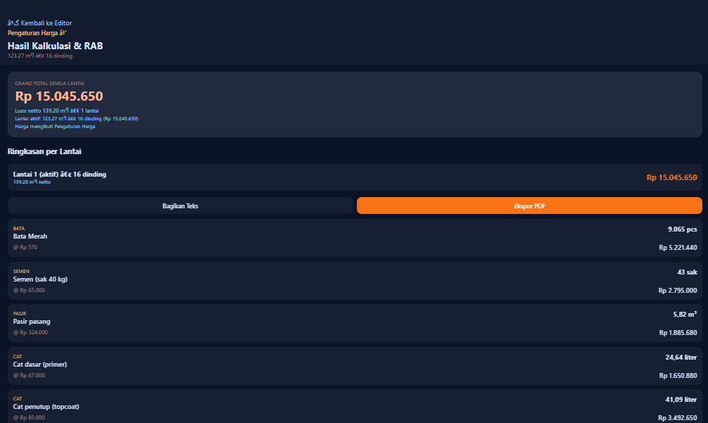

# Floorplan App — Kalkulator Material Dinding

Aplikasi mobile (Expo SDK 57 + TypeScript) untuk menghitung kebutuhan material dinding berdasarkan denah 2D. Pengguna bisa menggambar dinding, menambahkan ruangan, menempatkan bukaan (pintu/jendela), serta menyimpan dan mengekspor RAB.

## Fitur
- Denah 2D interaktif dengan titik sudut dan tata letak ruangan
- Penghitungan material otomatis (bata, semen, pasir, cat) dengan faktor 1,05
- Manajemen proyek dan ekspor RAB teks/PDF
- Login lokal (tanpa server, kata sandi hanya divalidasi di layar)
- Dukungan dedupe dinding berimpit (hitung sekali)

## Rumus Perhitungan Material
- **Bata**: `luas_netto × 70 × 1,05` (koefisien 70 bata/m²) — agar mudah diganti per jenis bata
- **Semen**: `(luas_netto × 11,5 / 40) × 1,05` sak 40 kg
- **Pasir**: `luas_netto × 0,045 × 1,05` m³
- **Cat dasar**: `luas_netto × 2 / 10` liter
- **Cat penutup**: `luas_netto × 2 × 2 / 12` liter
- Faktor 1,05 sesuai standar waste.

Catatan: rumus di `src/utils/calculator.ts` tidak berubah; hanya masukan luas/panjang dinding yang dihitung ulang di lapisan atas (`pricing.ts`) saat dedupe aktif.

## Menjalankan
```bash
npm install
npx expo start
```

Untuk pemeriksaan tipe:
```bash
npx tsc --noEmit
```

## Struktur Folder Singkat
- `src/types.ts`: model data (Point, Wall, Opening, Room, Project)
- `src/utils/geometry.ts`: logika murni titik, jarak, snap, moveEnd
- `src/utils/openings.ts`: posisi bukaan sepanjang dinding
- `src/utils/overlap.ts`: deteksi dinding berimpit
- `src/utils/rooms.ts`: analisis graf dan wajah ruangan
- `src/store/`: Zustand + persist (wallStore, authStore, priceStore, projectStore)
- `src/components/PlanCanvas.tsx`: kanvas denah 2D (SVG + PanResponder)
- `src/screens/EditorScreen.tsx`, `ResultScreen.tsx`, `LoginScreen.tsx`
- `src/utils/exportRab.ts`: ekspor teks dan HTML untuk PDF

## Batasan
- Login hanya lokal, tidak terhubung ke server
- Harga bawaan adalah perkiraan; pengguna bisa menyesuaikan di Pengaturan Harga
- Mortar ratio belum memengaruhi rumus material

# Floor Plan & Building Material Calculator

Aplikasi untuk menggambar denah rumah 2D dan menghitung kebutuhan material bangunan serta Rencana Anggaran Biaya (RAB). Dibuat dengan React Native (Expo), TypeScript, dan Firebase.

**Demo:** https://floorplan-rab.web.app

## Fitur

### Editor Denah 2D
- Gambar dinding langsung di kanvas, dengan snap grid, ortho, dan magnet
- Zoom dan geser (pan) kanvas, serta mode layar penuh
- Tambah ruangan dari preset (Kamar Tidur, Kamar Mandi, Dapur, Ruang Tamu, Garasi) atau ukuran kustom, dengan opsi Putar 90°
- Pintu dan jendela per dinding (ukuran dan posisi bisa diatur)
- Tombol Rapikan Sudut untuk merapikan ujung dinding yang menggantung
- Batalkan dan ulangi (undo/redo)

### Rumah Bertingkat
- Banyak lantai dalam satu proyek, dengan tab lantai
- Tambah lantai dengan opsi salin dari lantai bawah
- Bayangan samar lantai bawah sebagai acuan penempatan dinding

### Dinding Melengkung dan Sudut Bulat
- Dinding lurus dapat diubah menjadi lengkung (busur)
- Radius diatur lewat input, slider, atau seret handle di puncak busur; arah lengkung bisa dibalik
- Pintu dan jendela mengikuti kelengkungan dinding
- Sudut dinding dapat dibulatkan dengan radius tertentu, dan dikembalikan lurus

### Template Rumah
- Rumah Tipe 21, Tipe 36, Tipe 45, dan Tipe 48
- Pilihan mengganti denah yang ada atau memulai dari template

### Kalkulator Material dan RAB
- Luas netto dinding (luas pintu dan jendela dikurangkan); dinding lengkung memakai panjang busur
- Pilihan jenis bata (Bata Merah, Bata Ringan/Hebel, Batako) dan tipe adukan
- Input harga satuan untuk menghasilkan RAB
- Ringkasan per lantai dan grand total semua lantai
- Ekspor PDF dan bagikan teks RAB

### Akun dan Penyimpanan
- Daftar, masuk, dan keluar dengan email dan kata sandi (Firebase Authentication)
- Simpan, buka, dan hapus proyek (Cloud Firestore), termasuk banyak lantai dan dinding lengkung

## Teknologi
- React Native + Expo + TypeScript
- Zustand (state management)
- Firebase Authentication, Cloud Firestore, dan Firebase Hosting
- Dijalankan di browser (web) dan Expo Go (HP)

## Cara Menjalankan

### Prasyarat
- Node.js (LTS) dan npm
- Aplikasi **Expo Go** di HP (opsional)
- Project Firebase dengan Authentication (Email/Password) dan Firestore aktif

### Langkah
1. Clone repo dan masuk ke folder proyek:
   ```bash
   git clone <url-repo-ini>
   cd floorplan-app
   ```
2. Pasang dependensi:
   ```bash
   npm install
   ```
3. Buat file `.env` di root proyek dengan konfigurasi Firebase kamu (file ini tidak ikut di repo). Contohnya ada di `.env.example`:
   ```env
   EXPO_PUBLIC_FIREBASE_API_KEY=...
   EXPO_PUBLIC_FIREBASE_AUTH_DOMAIN=...
   EXPO_PUBLIC_FIREBASE_PROJECT_ID=...
   EXPO_PUBLIC_FIREBASE_STORAGE_BUCKET=...
   EXPO_PUBLIC_FIREBASE_MESSAGING_SENDER_ID=...
   EXPO_PUBLIC_FIREBASE_APP_ID=...
   ```
4. Jalankan aplikasi:
   ```bash
   npx expo start -c
   ```
   Tekan `w` untuk membuka di browser, atau scan QR code dengan Expo Go di HP.

### Build dan deploy web
```bash
npx expo export --platform web
firebase deploy --only hosting
```

## Cara Pakai Singkat
1. Daftar atau masuk dengan akun.
2. Mulai dari **Template** atau gambar dinding sendiri (mode Gambar).
3. Pilih dinding untuk mengatur panjang, tinggi, jenis bata, pintu, dan jendela. Aktifkan **Lengkung** untuk dinding melengkung.
4. Tambah ruangan lewat **+ Ruangan**, dan tambah lantai lewat **+ Lantai**.
5. Isi **Harga** material untuk melihat kebutuhan material dan RAB, lalu ekspor ke PDF.
6. Tekan **Simpan** agar proyek tersimpan di akun.

## Screenshot







## Catatan
- Warning `WebChannelConnection RPC 'Listen' stream transport errored` dari Firestore di konsol web berasal dari koneksi realtime yang terputus lalu tersambung ulang otomatis. Warning ini tidak memengaruhi fungsi aplikasi.
- File `.env` tidak disertakan di repo demi keamanan. Gunakan konfigurasi Firebase milik sendiri.
- Keterbatasan saat ini: fitur banyak bangunan dalam satu proyek belum tersedia.

## Pengembang
Dibuat sebagai tugas dari mentor.